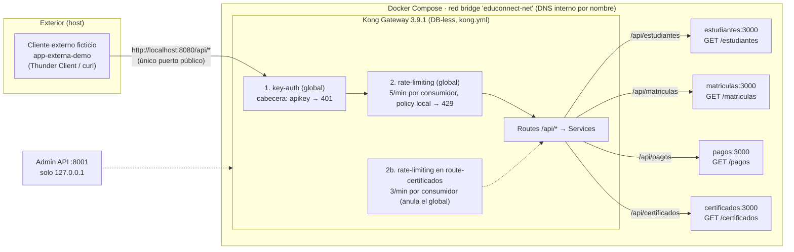

# EduConnect · PoC de API Gateway con Kong — Documento de entregables

Integrantes: Wilson Egas, Elizabeth Guerrón, Jean Luc Morales, Mayra Vargas y Mathias Vera.
Materia: Integración de Sistemas. Este documento reúne los entregables 4 (matriz de evidencias), 5 (diagrama), 6 (decisiones, AuthN/AuthZ, límites y mejoras) y 7 (uso de IA y fuentes). Las instrucciones de arranque están en el [README](../README.md).

**Contenido:** [1. Diagrama](#1-diagrama-de-arquitectura) · [2. Matriz de evidencias](#2-matriz-de-evidencias-por-reto) · [3. Decisiones, AuthN/AuthZ, límites y mejoras](#3-decisiones-arquitectónicas-authnauthz-límites-y-mejoras) · [4. Preguntas de reflexión](#4-preguntas-de-reflexión) · [5. Uso de IA y fuentes](#5-declaración-de-uso-de-ia-y-fuentes)

---

## 1. Diagrama de arquitectura

- Solo el puerto **8080** (proxy de Kong) es público; los backends no publican puertos, únicamente son alcanzables dentro de la red Docker. La Admin API se limita a `127.0.0.1:8001`.
- Kong resuelve `http://estudiantes:3000`, etc. con el **DNS interno de Docker** (el nombre del servicio de Compose), sin IPs fijas.

---

## 2. Matriz de evidencias por reto

Evidencia bruta: [`evidencias/salida-pruebas.txt`](evidencias/salida-pruebas.txt) (ejecución completa de `tests/pruebas.sh`: **19 pruebas, 0 fallas**) y [`evidencias/reto0-contenedores.txt`](evidencias/reto0-contenedores.txt).
Cliente de pruebas: Thunder Client (colección en `thunder-client/`) o `tests/pruebas.sh`.

### Reto 0 — Desplegar Kong con Docker Compose

| Campo | Registro |
|---|---|
| **Hipótesis** | Si defino Kong 3.9.1 y los backends en la misma red Compose, todos arrancarán y Kong alcanzará a los backends por nombre, porque Docker Compose registra cada servicio en el DNS de la red. |
| **Decisión** | `kong:3.9.1` fijada (no `latest`): rama 3.9 estable con documentación vigente de `key-auth`/`rate-limiting`; fijarla evita cambios silenciosos. Modo **DB-less** (`KONG_DATABASE=off` + `kong.yml`): sin Postgres, configuración versionada en Git, reproducible. Mocks en Node 20 alpine, sin dependencias. |
| **Prueba** | `docker compose ps` y `docker compose exec kong kong version` |
| **Resultado** | 5 contenedores *Up*, Kong *healthy*, versión `3.9.1`. Coincide con la predicción. Incidente: el puerto 8000 del host estaba ocupado por `wslrelay` (WSL) y respondía `{"detail":"Not Found"}` (formato que no es de Kong); se detectó con `Get-NetTCPConnection` y se publicó Kong en **8080**. |
| **Limitación** | Solo demuestra disponibilidad local. Una sola instancia: no hay alta disponibilidad. |

**¿Cómo se comunica Kong sin IPs rígidas?** El Service de Kong usa el *nombre* (`estudiantes`, `pagos`…). El DNS embebido de Docker resuelve ese nombre a la IP actual del contenedor dentro de `educonnect-net`; si el contenedor se recrea con otra IP, el nombre sigue siendo válido.

### Reto 1 — Unificar el punto de acceso

| Campo | Registro |
|---|---|
| **Hipótesis** | Con tres Services y tres Routes (`/api/x`, `strip_path: true`, Service con path `/x`), `GET /api/x` llegará a `/x` del backend correcto y responderá 200 con su JSON. |
| **Decisión** | Un Service por backend (destino) y una Route por prefijo público (criterio). `methods: [GET]` limita la superficie a lo necesario. |
| **Prueba** | `GET http://localhost:8080/api/{estudiantes,matriculas,pagos}` (con API Key, ver Reto 2). |
| **Resultado** | 200 en las tres; la cabecera `X-Served-By` y el campo `servicio` del JSON identifican quién respondió. Coincide. |
| **Limitación** | Los mocks son estáticos: no se prueban payloads grandes, otros métodos ni rutas con parámetros (`/estudiantes/101`). |

**Service vs Route.** El **Service** es el *destino* (protocolo, host, puerto y path de la API real). La **Route** es el *criterio de coincidencia* (método, path, host…) que decide qué peticiones públicas se dirigen a un Service. **Si cambia la dirección interna de un backend**, solo se edita la `url` del Service en `kong.yml`; las Routes y los clientes (`/api/...`) no cambian.

### Reto 2 — API Key

| Campo | Registro |
|---|---|
| **Hipótesis** | Con `key-auth` global: sin clave → 401, clave errónea → 401, clave válida → 200, porque Kong valida la credencial contra los Consumers antes de enviar al backend. |
| **Decisión** | Plugin **global** (deny-by-default: una ruta nueva nace protegida). Cabecera `apikey`; `hide_credentials: true` evita reenviar la clave al backend. Consumidor ficticio `app-externa-demo` con clave de demostración `demo-key-educonnect-2026` (no es un secreto real). |
| **Prueba** | `GET /api/estudiantes` sin cabecera / con `apikey: incorrecta` / con `apikey: demo-key-educonnect-2026`. |
| **Resultado** | 401 `No API key found in request`; 401 `Unauthorized`; 200. Coincide. Además, una ruta inexistente **con** clave devuelve 404 (Kong resuelve la Route antes de ejecutar plugins). |
| **Limitación** | La clave viaja en claro por HTTP (sin TLS en la PoC), está en el repositorio y no hay rotación ni expiración. |

**AuthN vs AuthZ.** *Autenticación* responde «¿quién eres?» (la API Key identifica al consumidor `app-externa-demo`). *Autorización* responde «¿qué puedes hacer o ver?». Una clave válida no prueba que ese consumidor pueda ver *cualquier* matrícula o dato personal: identifica a una aplicación, no dice a qué estudiantes tiene derecho. Esa decisión (propiedad del recurso, consentimiento, rol; riesgo BOLA/IDOR de OWASP API Security) debe tomarla cada sistema de negocio; el gateway no la resuelve.

### Reto 3 — Rate limiting

| Campo | Registro |
|---|---|
| **Hipótesis** | Con `rate-limiting` `minute: 5`, las solicitudes 1–5 de una ventana darán 200 y la 6.ª 429, porque se supera el contador por consumidor. |
| **Decisión** | Plugin global, `limit_by: consumer`, `policy: local`. Se ejecuta tras `key-auth` (que identifica al consumidor). `fault_tolerant: true`. |
| **Prueba** | Ventana iniciada a las **23:45:01**: 5 × `GET /api/estudiantes` con clave válida, luego solicitud 6 y solicitud 7 (`/api/pagos`). |
| **Resultado** | 1–5 → 200; 6 → **429** `API rate limit exceeded`; 7 (otra ruta) → 429; cabeceras `X-RateLimit-Limit-Minute: 5`, `X-RateLimit-Remaining-Minute: 0`, `Retry-After: 58`. Coincide. Observación: la ventana de minuto se alinea al reloj, por eso el script espera al siguiente minuto. |
| **Limitación** | Con `policy: local` el contador vive en la memoria de *esa* instancia y se pierde al reiniciar Kong. Un 429 en una instancia no prueba el límite global de un clúster. |

**Alcance real:** global por consumidor — **un contador compartido entre `/api/estudiantes`, `/api/matriculas` y `/api/pagos`** (confirmado: la solicitud 7 a otra ruta recibió 429). No es un límite por ruta.

**Varias instancias del gateway.** Con contador local, N instancias detrás de un balanceador permiten hasta N × 5 solicitudes/min (según el reparto). En una arquitectura empresarial se usa `policy: redis` (contador compartido; añade latencia y un punto de falla), `policy: cluster` con base de datos (menos recomendable por carga) o balanceo con afinidad por consumidor.

### Reto 4 — Verificación, ruta no registrada y backend caído

| Campo | Registro |
|---|---|
| **Hipótesis** | (a) Ruta no registrada → 404 de Kong. (b) Con `pagos` detenido → **503** (suponíamos fallo de resolución DNS del nombre). |
| **Decisión** | Colección Thunder Client (`thunder-client/`) y `tests/pruebas.sh` equivalente por consola, ejecutable de punta a punta. |
| **Prueba** | (a) `GET /api/inexistente` con clave válida. (b) `docker compose stop pagos`, luego `GET /api/pagos` con clave válida. |
| **Resultado** | (a) **404** `no Route matched with those values`. (b) **502** `An invalid response was received from the upstream server`. **Difiere de la predicción (503).** El log de Kong muestra `connect() failed (113: No route to host) ... upstream: http://172.18.0.4:3000/pagos`: Kong conservaba la IP resuelta del contenedor detenido, intentó conectar, falló y devolvió 502 (*Bad Gateway*: no obtuvo respuesta válida del upstream). Un 503 aparecería si el nombre ya no resolviera. |
| **Limitación** | El código depende de caché DNS, timeouts y reintentos de Kong; no es un contrato estable. No se probó latencia alta (504) ni *health checks* / circuit breaker. |

### Desafío de transferencia — Certificados Académicos

| Campo | Registro |
|---|---|
| **Hipótesis** | Un cuarto mock más Service/Route `/api/certificados` heredará `key-auth` global. Un `rate-limiting` en la **Route** (3/min) reemplazará al global (5/min) solo para esa ruta, porque Kong aplica el plugin del alcance más específico. |
| **Decisión** | Cambios: servicio `certificados` en `docker-compose.yml`, Service+Route en `kong.yml` y `rate-limiting` `minute: 3` en la Route. Se eligió alcance Route y no Consumer porque un plugin ligado al consumidor es *más* específico que uno de Route y habría anulado el límite del endpoint; así el límite depende del *endpoint*. No se modificó ningún backend ni cliente existente. |
| **Prueba** | `GET /api/certificados` sin clave; luego 4 solicitudes con clave válida. |
| **Resultado** | Sin clave → 401; solicitudes 1–3 → 200 (`{"servicio":"certificados",...}`); 4.ª → **429**; `X-RateLimit-Limit-Minute: 3`. El contador de `/api/estudiantes` es independiente. Coincide. |
| **Limitación** | Mismo contador local por instancia. Los límites más avanzados (p. ej. por plan o varias ventanas con más control) requieren plugins de la edición Enterprise; aquí solo se usa OSS. |

---

## 3. Decisiones arquitectónicas, AuthN/AuthZ, límites y mejoras

*(Documento corto — extensión objetivo ≤ 2 páginas.)*

**Decisiones.** (1) Kong OSS **3.9.1 fijada**, DB-less: configuración en un archivo versionado y reproducible, sin base de datos; el costo es que cambiar la configuración exige reiniciar/recargar y no hay Admin API de escritura. (2) Una única entrada pública (`:8080`); backends sin puertos publicados. (3) `key-auth` y `rate-limiting` **globales** (seguro por defecto) con una excepción explícita en Certificados. (4) Mocks genéricos en Node: una sola imagen parametrizada por variable de entorno.

**AuthN vs AuthZ.** El gateway *autentica* aplicaciones (API Key → Consumer). No *autoriza* operaciones de negocio ni identifica usuarios finales: una clave válida no implica permiso sobre una matrícula concreta. La autorización por recurso (¿este consumidor/usuario puede ver este estudiante?) debe vivir en cada servicio, idealmente apoyada en identidad federada (OAuth2/OIDC con JWT) y en el contexto del usuario final.

**Límites de la PoC.** HTTP sin TLS; clave en el repositorio y sin rotación; un solo consumidor; sin autorización de negocio; sin identidad de usuarios finales; contador de rate limiting local (por instancia, volátil); una sola instancia de Kong (sin alta disponibilidad); sin monitoreo distribuido (solo logs en consola); sin *health checks*; mocks estáticos; Admin API sin autenticación (solo limitada a localhost).

**Mejoras para producción con varias instancias.** TLS en el borde y mTLS hacia backends; secretos en un gestor (no en Git) y rotación de claves; OAuth2/OIDC/JWT además de API Key; autorización por recurso en los servicios; `rate-limiting` con **Redis** para contador compartido; ≥2 instancias de Kong tras un balanceador, con configuración distribuida (modo híbrido o despliegue declarativo desde CI/CD); *health checks* activos/pasivos y timeouts/reintentos explícitos; observabilidad (Prometheus + Grafana, trazas con OpenTelemetry, `correlation-id`, logs centralizados); protección de la Admin API (RBAC/red privada); WAF y límites de tamaño de petición.

---

## 4. Preguntas de reflexión

1. **¿Qué incidentes del caso se reducen y cuáles permanecen?** Se reducen: el acceso directo a las APIs (los backends no están expuestos), las políticas heterogéneas de autenticación (una sola en el borde), la sobrecarga por consumidores (límite de tráfico) y parte de la visibilidad (log central de accesos). Permanecen: autorización de negocio, identidad de usuarios finales, monitoreo integral/trazabilidad distribuida y alta disponibilidad.
2. **¿Por qué el gateway no elimina la obligación de autorizar dentro de los sistemas?** Porque solo conoce la identidad del *consumidor* y la ruta, no la semántica del dato (de quién es la matrícula). Además, quien evada el gateway (red interna, credencial robada) llegaría a servicios sin controles propios: se necesita defensa en profundidad.
3. **Ventaja y riesgo de centralizar.** Ventaja: políticas transversales (seguridad, tráfico, observabilidad) en un solo punto, sin tocar los sistemas. Riesgo: punto único de falla, de ataque y cuello de botella; una mala configuración afecta a todas las APIs.
4. **Qué modificar antes de producción con múltiples instancias:** ver «Mejoras para producción» (contador compartido en Redis, alta disponibilidad, TLS, secretos, observabilidad, autorización por recurso).

---

## 5. Declaración de uso de IA y fuentes

**Uso de IA.** Se utilizó un asistente de IA generativa (Claude Code) como apoyo para estructurar el repositorio, redactar la configuración, los mocks, los scripts y este documento, y para depurar. Las pruebas se ejecutaron realmente en un entorno local y los resultados citados provienen de esas ejecuciones (ver `docs/evidencias/`). Hallazgos de depuración: el puerto 8000 ocupado por WSL, el 502 (en lugar del 503 supuesto) con el backend caído y la precedencia entre alcances de plugins. Cada decisión debe ser contrastada por el equipo con la documentación oficial; la IA no se cita como justificación.

**Fuentes consultadas.**
- Kong Gateway: https://developer.konghq.com/gateway/
- Kong DB-less: https://developer.konghq.com/gateway/db-less-mode/
- Kong Key Authentication: https://developer.konghq.com/plugins/key-auth/
- Kong Rate Limiting: https://developer.konghq.com/plugins/rate-limiting/
- Docker Compose: https://docs.docker.com/compose/
- Thunder Client: https://www.thunderclient.com/
- OWASP API Security: https://owasp.org/API-Security/
